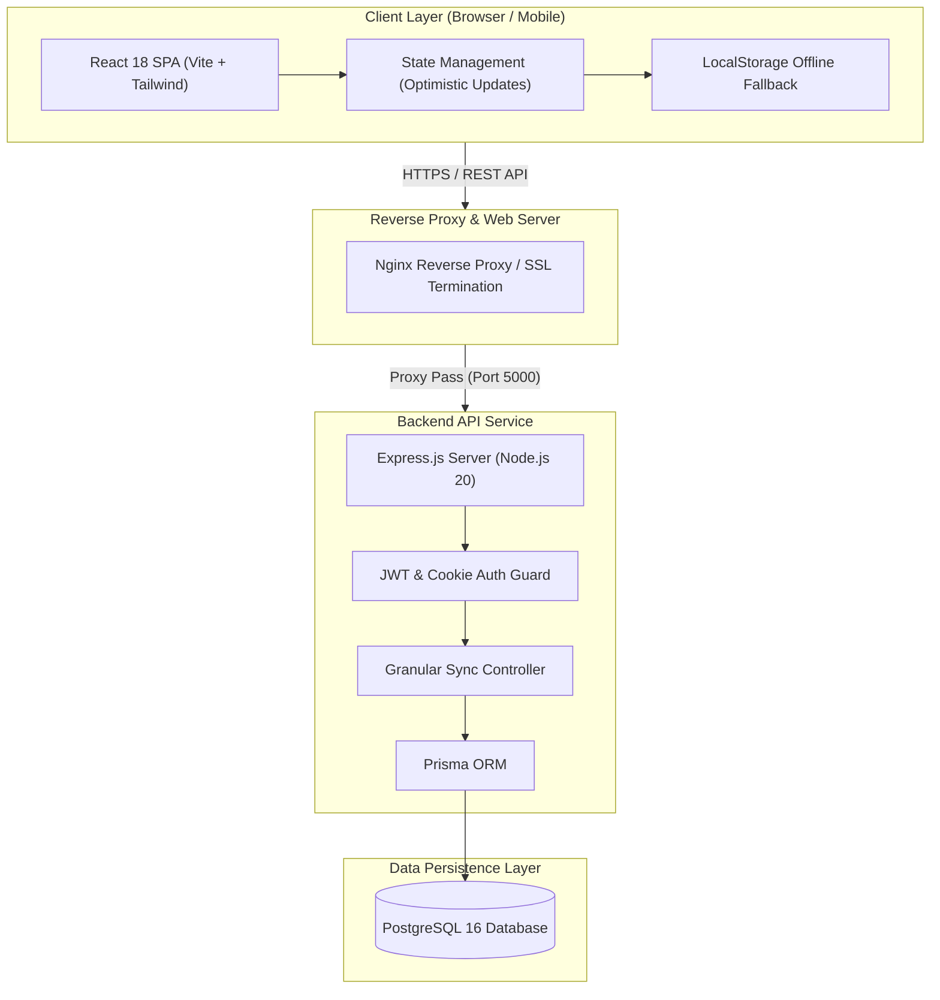

<div align="center">

# Forbidden Forest
### *RPG-Gamified Medical Journey & UKMPPD Preparation Platform*

[](https://www.typescriptlang.org/)
[](https://react.dev/)
[](https://vitejs.dev/)
[](https://nodejs.org/)
[](https://expressjs.com/)
[](https://www.postgresql.org/)
[](https://www.prisma.io/)
[](https://tailwindcss.com/)
[](https://www.docker.com/)

<p align="center">
  A fullstack productivity and clinical tracking platform engineered to support Indonesian medical students, clinical clerks (koas), and medical doctors preparing for UKMPPD certification and residency (PPDS). Combines clinical standards compliance with Hogwarts-inspired RPG gamification mechanics and granular multi-device synchronization.
</p>

</div>

---

## Overview

Medical school and residency preparation require managing hundreds of clinical competencies, Objective Structured Clinical Examinations (OSCE), rotational clinical stases, and computer-based test (CBT) mock exams. **Forbidden Forest** addresses this complexity by merging clinical-grade tracking with gamification mechanics:

- **Indonesian Medical Education Standards**: Native alignment with SKDI 4A competency diseases, clinical rotations, OSCE procedural rubrics, and UKMPPD score targets.
- **Gamification Mechanics**: Experience points (XP) calculation based on completed clinical tasks, milestone progression (Co-Assistant to Specialist Doctor), daily study streaks with freeze mechanisms, companion dialogues, and auditory feedback.
- **Granular Cloud Sync**: Replaces monolithic state replacement with atomic, field-level REST synchronization. Updates sync reliably across devices with optimistic UI rendering and zero cross-device state overwrite.
- **Enterprise-Grade Security**: Dual-token JWT authentication (short-lived access tokens + HTTP-only secure refresh tokens with automatic token rotation), BCrypt password hashing, and Google OAuth 2.0 integration.
- **Production & DevOps Architecture**: Fully containerized with multi-stage Docker builds, Nginx reverse proxy, automated GitHub Actions CI/CD pipeline, and zero-downtime deployment.

---

## Modules & Capabilities

| Module | Description |
| :--- | :--- |
| **Markas & Status** | Central command dashboard with interactive journey map, daily habit tracker, XP level progress bar, and clinical milestones. |
| **Roadmap & Stase** | Rotational department planner (Bedah, Penyakit Dalam, Obgyn, Anak, etc.) tracking case logs, supervisor verifications, and clinical requirements. |
| **SKDI Matrix** | Comprehensive tracker for 4A competency diseases, diagnostic criteria, and national therapy standards. |
| **OSCE Station Master** | Simulated clinical exam simulator with dynamic countdown timers, step-by-step physical examination checklists, and scoring rubrics. |
| **Tryout Diagnostic Hub** | CBT mock exam analytics tracking score trajectories, target margins, and weak-spot subject identification. |
| **Buku Catatan Kesalahan (Error Book)** | Spaced repetition system for cataloging missed questions, retrospective diagnosis errors, and high-yield clinical pearls. |
| **Intensif UKMPPD** | Dedicated countdown timer, high-yield drill down, and daily revision timetable. |
| **Data Portability & Offline Support** | Full JSON backup/export, local storage fallback when disconnected, and instant seed template restoration. |

---

## System Architecture



---

## Tech Stack & Architecture Decisions

### Frontend
- **Framework**: React 18 with TypeScript for type safety and scalability.
- **Build Tool**: Vite 6 for optimized build times and modern asset bundling.
- **Styling**: Tailwind CSS with a customized retro warm parchment theme palette designed to eliminate high-contrast glare during extended night study sessions.
- **Visuals & Feedback**: Lucide React for clean iconography, Canvas Confetti for milestone animations, and Howler.js for retro audio cues.

### Backend
- **Runtime**: Node.js 20 (LTS).
- **Framework**: Express.js with TypeScript.
- **ORM & Database**: Prisma ORM with PostgreSQL 16.
- **Security**: `bcryptjs` for password hashing, `jsonwebtoken` for stateless auth tokens, `cookie-parser` for secure HTTP-only cookies, and `cors` origin whitelisting.

### Infrastructure & CI/CD
- **Containerization**: Multi-stage Docker builds and Docker Compose orchestration.
- **Reverse Proxy**: Nginx configured with gzip compression, security headers, and single-page routing fallback.
- **CI/CD Pipeline**: GitHub Actions workflow running automated TypeScript linting, build verification, GHCR container publishing, and zero-downtime SSH VPS deployment.

---

## Getting Started

### Prerequisites
- Node.js v20+ and `npm`
- Docker & Docker Compose (for containerized setup)
- PostgreSQL v15+ (if running bare metal)

### Option 1: Quickstart via Docker Compose (Recommended)

1. **Clone the repository:**
   ```bash
   git clone https://github.com/USERNAME/forbidden-forest.git
   cd forbidden-forest
   ```

2. **Configure environment variables:**
   ```bash
   cp .env.example .env
   ```

3. **Launch the fullstack application:**
   ```bash
   docker compose up --build -d
   ```
   - Frontend will be accessible at: `http://localhost:3080` (or configured port)
   - Backend API at: `http://localhost:5000`

---

### Option 2: Local Development Setup (Bare Metal)

#### 1. Backend Setup
```bash
cd backend
cp .env.example .env
npm install

# Run database migrations
npx prisma migrate dev --name init

# Start backend server in development mode
npm run dev
```

#### 2. Frontend Setup
```bash
# Return to root directory
cd ..
npm install

# Start Vite development server
npm run dev
```
Open [http://localhost:5173](http://localhost:5173) in your browser.

---

## Repository Structure

```text
forbidden-forest/
├── .github/workflows/         # CI/CD deployment automation (GitHub Actions)
├── backend/                   # Express.js REST API & Database Service
│   ├── prisma/                # Prisma schema & database migration history
│   ├── src/
│   │   ├── config/            # Environment validation & secrets configuration
│   │   ├── controllers/       # Auth, Onboarding, Tracker & Granular Sync controllers
│   │   ├── lib/               # Database client (Prisma instance)
│   │   ├── middlewares/       # JWT auth guard, error handling, validation
│   │   ├── routes/            # Express route declarations
│   │   ├── services/          # Business logic & initial template generators
│   │   └── index.ts           # Server entry point
│   ├── Dockerfile             # Multi-stage backend production container
│   └── package.json
├── nginx/                     # Reverse proxy configuration
├── public/                    # Static assets, stethoscope logos, audio clips
├── src/                       # React 18 Frontend Application
│   ├── components/            # UI Modals & Tab views (Dashboard, SKDI, OSCE, Tryout, etc.)
│   ├── context/               # React Context Providers (AppContext, AuthContext)
│   ├── data/                  # Offline template data & seed initializers
│   ├── services/              # Axios / Fetch HTTP client with sync dispatcher
│   ├── types/                 # Shared TypeScript interfaces & types
│   ├── utils/                 # Companion quotes, XP algorithms, date helpers
│   ├── App.tsx                # Main layout shell & tab routing
│   └── main.tsx               # DOM root mounting
├── docker-compose.prod.yml    # Production orchestration configuration
├── docker-compose.yml         # Local development container orchestration
├── Dockerfile.frontend        # Multi-stage Nginx-bundled frontend container
├── tailwind.config.js         # Theme & custom parchment color palette
└── vite.config.ts             # Vite build & plugin configuration
```

---

## Security & Data Privacy

- **Zero Credential Leakage**: All `.env` secrets, database passwords, and API keys are strictly excluded from version control via `.gitignore`.
- **Cookie-Based Token Architecture**: Access tokens are kept in memory/auth headers, while Refresh Tokens are stored strictly in `HttpOnly`, `SameSite=Lax/Strict`, `Secure` cookies to defend against XSS token exfiltration.
- **Defensive Input Handling**: Sensitive fields are validated and scrubbed before database commits; cross-user synchronization is authenticated and strictly isolated at the database user ID level.

---

## Author

**Ahmad Fatih**
- Institution: Universitas Indonesia (UI)
- Email: [ahmad.fatih22@ui.ac.id](mailto:ahmad.fatih22@ui.ac.id)
- GitHub: [@ahmadfatih](https://github.com/)

---

## License

This project is licensed under the [MIT License](LICENSE).
